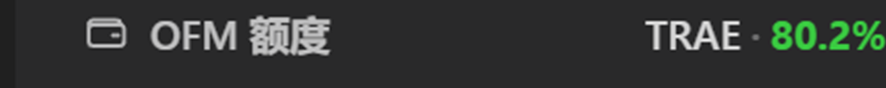
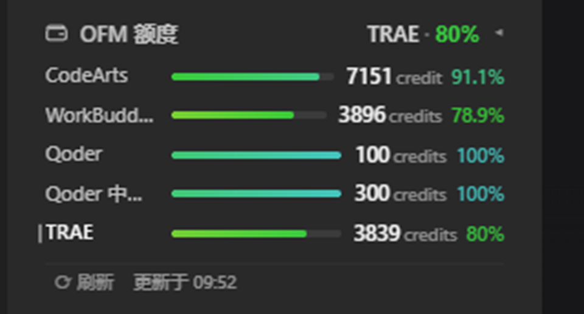

<div align="center">


# dsh-ofm-balance

**Per-channel credit balances for the [Our Free Model](https://github.com/Ebony-Vinyl/dsh-our-free-model) (OFM) gateway, shown in the DSH sidebar.**

> One small always-on card that lays out "which channel still has how much left".

[](README.md)
[](README.en.md)

[](package.json)
[](LICENSE)
[](https://github.com/Shen-18/dsh-ofm-balance)
[](package.json)

</div>

---

## Preview

<table>
  <tr>
    <td align="center" width="42%">
      
      <br /><sub><b>Collapsed</b> — the channel your current conversation is using, and what is left</sub>
    </td>
    <td align="center" width="58%">
      
      <br /><sub><b>Expanded</b> — one row per channel: bar · remaining · percentage</sub>
    </td>
  </tr>
</table>

- **Collapsed**: the channel your current conversation is using, with its remaining percentage, as
  `channel · pct`. When the current channel cannot be resolved it falls back to the channel with the
  least left — usually the one you actually want to look at.
- **Expanded**: one row per channel with a bar, the remaining amount and the percentage, read from
  the gateway's real quota endpoint.
- **Refresh**: click to probe immediately; when the page is visible the card polls on an interval.

## What it is for

OFM puts a dozen channels (CodeArts, TRAE, Qoder, …) behind a single gateway. Each one carries its own
quota, and the gateway only tells you when you go ask. Two questions follow:

- "Which channel did that request just spend?" — the collapsed card answers it.
- "Which channel is about to run out?" — sorted by remaining, one glance.

The card puts both in the sidebar: no conversation space, no click, no interruption.

## Which channels are shown

The plugin lists **every channel the gateway supports**, not just the ones that currently have a
routable model.

This matters. `GET /v1/models` **only reports channels that have a model available right now**: a
channel with no logged-in account, or with no model currently servable, simply will not appear there —
yet it is still a supported channel, and its balance endpoint still answers. So the channel source
here is a full catalogue, with `/v1/models` used only as a supplement:

| Source | Where it comes from | Meaning |
| --- | --- | --- |
| **configured** | the DSH profile's route entries: model ids declared under that route | you have models going through this channel |
| **catalogue** | the plugin's built-in list (matching the gateway console, 13 today) | which channels the gateway supports |
| **advertised** | `GET /v1/models` → `data[].channel` | a model is available right now |
| **readable** | the gateway's `credits.balances` returned numbers | a balance is readable right now |

> **The catalogue is a floor, not a filter.** A channel the gateway advertises but the catalogue has
> never heard of is still listed, under a title-cased display name. The plugin keeps working when the
> gateway adds a channel — and a unit test guards exactly that:
> `a channel outside the catalogue still appears when the gateway advertises it`.

### Defaults

| Situation | Default behaviour |
| --- | --- |
| Configured channel | **Shown.** Even when the gateway cannot read a balance, the row stays and says why — you configured it, so hiding it would mislead |
| In the catalogue but not configured | **Hidden.** Can be turned on by hand to inspect those balances |
| Configured but unreadable | **Shown**, labelled honestly (e.g. "the gateway does not provide this channel") |
| Channel with no logged-in account | The query succeeds but returns an empty account list; shown as **"not signed in to this channel"** |
| Not configured but manually revealed | **Shown**, annotated "no models configured for this channel yet — inspection only" |

A channel with no account is labelled honestly rather than reported as an error or left blank:
"could not read" and "nothing there" are different facts, and the card keeps them apart.

### Adjusting it (GUI)

Open the plugin's detail page on DSH's **Plugins** page; the **channel visibility** block at the top
of the body is the toggle panel. Channels are split into two groups:

- **Configured** — your DSH has models going through these
- **Other channels the gateway supports** — in the catalogue, not configured by you

Each row has:

- a checkbox on the left controlling visibility
- the channel name plus a one-line note (configured / no models configured in DSH / not currently offered by the gateway)
- a status chip on the right

**Revealing an unconfigured channel asks for confirmation**, because such a channel can only be
inspected, not used through this harness. Changes apply immediately and are written to
`$DSH_HOME/dsh-ofm-balance/settings.json`.

> **Why not the host's generated settings form?** DSH derives a settings page from the plugin's
> `Config` schema, but it renders scalar fields only; an `array` channel list gets no usable
> checkboxes there, and it cannot ask the confirmation question when revealing an unconfigured
> channel. So this plugin ships its own panel.

#### Why the block can sit above "Source information"

The panel registers through the `plugins.detail.section` slot, which is **appended after** the
official page's own blocks (source information, current version, updates) — the `order` given at
registration sorts within the slot only and cannot change the position relative to official blocks.

So the position is guaranteed by two things together:

1. the detail page body is `flex-direction: column`, and the panel's root carries `order: -1`, which
   sorts it first at the CSS level;
2. the render callback performs one conservative prepend (only when the parent really is a flex
   column), as a fallback for when CSS is unavailable.

Neither depends on the host's internal ordering. If the host changes its layout the panel falls back
to the position the slot gave it, rather than erroring.

### Adjusting it (config file)

You can also edit `$DSH_HOME/dsh-ofm-balance/settings.json` directly:

```json
{
  "version": 1,
  "hidden": ["qoder"],
  "revealed": ["moonshot"]
}
```

| Field | Effect |
| --- | --- |
| `hidden` | **Configured** channels to hide |
| `revealed` | **Unconfigured** channels to additionally show |

Delete the file to restore defaults (all configured shown, all unconfigured hidden).
**Hidden channels are not probed, so they cost no requests.**

## Colour

The bars and percentages follow the **remaining** ratio as a continuous gradient — not the consumed
ratio, and not a stepped scale.

The hue was tuned against real data. The first version spread the hue linearly across the whole
range, which produced an indistinguishable band of green through the healthy end (80% → 100% spanned
only 23°). It now uses anchors that push the top of the range toward cyan:

| Remaining | Hue | Reading |
| ---: | ---: | --- |
| 100% | 178° | cyan |
| 90% | 147° | spring green |
| 80% | 123° | green |
| 60% | 78° | yellow-green |
| 40° | 48° | amber |
| 20° | 25° | orange |
| 0% | 0° | red |

Saturation and lightness vary with the value too, so the scale reads as a continuous gauge rather
than a colour wheel. **The semantics never invert**: 100% is always healthy cyan, 0% always red.

In the collapsed summary, the channel name keeps the default text colour and **only the percentage is
tinted** — colouring both makes the name read like a status label and competes with the number.

## Install

```bash
dsh plugin --profile <profile> add github:Shen-18/dsh-ofm-balance
```

A repository URL or a local path works just as well:

```bash
dsh plugin --profile <profile> add https://github.com/Shen-18/dsh-ofm-balance
dsh plugin --profile <profile> add link:/absolute/path/to/dsh-ofm-balance
```

> Your profile may not be called `web`; substitute your own (desktop builds commonly use `desktop`).

Manual install:

1. add this directory to the profile's `package.json` → `dependencies`
2. append the package name `dsh-ofm-balance` to `dsh.profile.bundles`
3. run `pnpm install` in the profile directory
4. restart the host

Host-half changes need a restart; browser-half changes need only a page refresh.

## Configuration

Deployment-level settings on the host side (in the profile patch or the plugin's config):

| Key | Default | Meaning |
| --- | --- | --- |
| `enabled` | `true` | Master switch; when off, nothing is probed and no route is registered |
| `baseUrl` | `http://127.0.0.1:18900` | gateway address |
| `credentialRoute` | `ourfreemodel` | the provider route the credential and configuration belong to |
| `pollIntervalSec` | `60` | poll interval (30–3600 s) |
| `timeoutMs` | `20000` | per-channel timeout. Cold start measured around 10.5 s; do not lower it much |
| `hiddenChannels` | `[]` | (initial value) configured channels to hide |
| `revealedChannels` | `[]` | (initial value) unconfigured channels to additionally show |

> The **live** toggle values live in `$DSH_HOME/dsh-ofm-balance/settings.json`, maintained by the
> detail-page panel. `hiddenChannels` / `revealedChannels` in the config are first-run initial values.

## HTTP API

Every route is **loopback-only** (anything other than `127.0.0.1` / `::1` gets a `403`). The API key
is resolved by the host and never sent to the browser.

| Method | Path | Purpose |
| --- | --- | --- |
| `GET` | `/api/dsh-ofm-balance/overview` | current snapshot and probe report |
| `POST` | `/api/dsh-ofm-balance/refresh` | probe now and return a fresh snapshot |
| `GET` | `/api/dsh-ofm-balance/channels` | the channel classification (with display labels) for the settings panel |
| `POST` | `/api/dsh-ofm-balance/visibility` | persist the channel toggles, body `{ hidden, revealed }` |

## Where the data comes from

The host side talks to the local gateway directly:

| Purpose | Endpoint |
| --- | --- |
| discover channels | `GET {baseUrl}/v1/models` → `data[].channel` |
| query a balance | `POST {baseUrl}/api/management/channels/rpc`, method `credits.balances`, params `{ provider }` |

The credential is read from the host credential service as `OURFREEMODEL_API_KEY` and **used only
inside the host process**.

## Cold start

The plugin mounts before the credential service is ready. How it handles that:

- when no credential is available the failure is **not cached**; channels are marked "reading" and
  retried after 1 second;
- only after three consecutive misses is a channel treated as genuinely unconfigured, and the card
  then gives an actionable hint (which environment variable to set);
- the gateway's first cold probe takes about 10.5 s, so the first request returns placeholder rows
  that already carry channel names, with the numbers filled in afterwards — never a blank card.

The result: **balances appear on their own after DSH opens**, with no manual refresh.

## Known limitations

- The gateway has **no batch endpoint**, so each probe fans out per channel; hidden channels are not
  requested at all.
- `gemini`'s quota query needs the machine to reach Google. Without a proxy that channel returns
  `balance: null` with a network-failure note, is shown as "unavailable", and **does not affect other
  channels**; it recovers on the next round once a proxy is available.
- Some credit bundles the gateway returns **contain** others. The remaining amount follows the
  gateway's `balance.total` (the account-wide figure), but the **denominator must not** simply sum
  every bundle's `used`: the same `used` appears in both the aggregate bundle and its children
  (codearts' 总积分包 and 赠送积分包 both report `used` 349.31), and adding them inflates the
  denominator. The correct denominator finds the bundle whose `remaining` equals `balance.total`
  and uses **that bundle's own** `used` as the consumed side (codearts: `7150.69 + 349.31 = 7500`,
  matching that bundle's `total` field). When no such aggregate exists the bundles are independent
  and summing them is correct.
- When no account is signed in for a channel, the balance endpoint **still answers** and simply
  returns an empty account list; the plugin labels it honestly rather than counting it as a failure.

## Design notes

| Decision | Why |
| --- | --- |
| Split host / browser halves | the API key stays inside the host process; the browser only sees a normalised snapshot |
| `Promise.allSettled` fan-out | one slow or failing channel must not drag the others down |
| Cache-first with a warm-up state | cold start is ~10.5 s; the first request returns placeholder rows to avoid a blank first paint |
| A missing credential is not cached | at cold start the credential service comes up after the plugin, so caching "no key" turns one transient state into a permanent error |
| Classification rules extracted to `lib/channels.js` | pure functions, no I/O: that is where the policy lives and what is most worth testing |
| Channel toggles go through `plugins.detail.section` | the host's generated form cannot render array fields, nor ask the "unconfigured channel" confirmation |
| Toggles stored in their own JSON rather than the profile patch | the plugin is mounted by a bundle patch, so there is no row in the profile to edit; writing its own file cannot damage the user's config |
| Display labels come from the host | the plugin still names channels correctly on gateway deployments that offer unknown ones, falling back to title-casing |

## File layout

| File | Responsibility |
| --- | --- |
| `lib/gateway.js` | gateway protocol: channel discovery, balance queries, normalisation |
| `lib/channels.js` | channel classification and visibility policy (pure functions) |
| `lib/service.js` | cache, polling, credential-readiness retry, snapshot building |
| `lib/patch.js` | persistence of the channel toggles (atomic: temp file then rename) |
| `lib/index.js` | host mounting, routes, configuration, session events |
| `lib/client.js` | the sidebar card and the detail-page channel toggle panel |

Zero runtime dependencies. `@deepseek-ai/*` is entirely host-provided and never declared as a
`dependency`.

## Supported channels

The built-in catalogue (matching the gateway console):

| id | Name | Vendor |
| --- | --- | --- |
| `codearts` | CodeArts | Huawei Cloud |
| `buddy` | WorkBuddy (CN) | Tencent |
| `workbuddy` | WorkBuddy (intl.) | Tencent |
| `lobsterai` | LobsterAI | Youdao |
| `qoder` | Qoder | Alibaba |
| `qodercn` | Qoder (CN) | Alibaba |
| `trae` | TRAE | ByteDance |
| `cline` | Cline | — |
| `loomy` | Loomy | — |
| `raccoon` | Raccoon | — |
| `minimax` | MiniMax Code | — |
| `zcode` | ZCode | — |
| `gemini` | Gemini | Google |

That catalogue is a **floor rather than a filter**: channels with no logged-in account are shown
honestly, and channels outside the catalogue appear as usual.

## Development

```bash
npm run check   # syntax check (node --check)
npm test        # unit tests: channel classification + settings persistence (node --test)
```

The tests cover the classification policy and the boundary cases of settings persistence (missing
file, corrupt file, atomic write, tolerance of unknown shapes). They need no network and spend no
quota.

## Version

- **0.5.1** — fixed a double-counted denominator in the percentage. The gateway repeats the same
  `used` figure in both an aggregate bundle and its children (codearts' 总积分包 and 赠送积分包 both
  report 349.31), so summing them inflates the divisor. The denominator now finds the bundle whose
  `remaining` equals `balance.total` and uses **that bundle's own** `used`: codearts moves from
  91.1% (7849.31) to the correct **95.3% (7500)**, matching that bundle's `total` field. Added
  `lib/gateway.test.js`, pinning the arithmetic and the empty/no-balance fallbacks against real
  gateway responses.
- **0.5.0** — lists **every channel the gateway supports** (rather than only those with a routable
  model), completed by the built-in catalogue; channels with a signed-in account report balances
  normally, those without are labelled honestly. Configured-channel detection gained a file fallback
  (some hosts do not expose the route settings namespace to plugins, which previously made every
  channel look unconfigured). The settings panel moved to a grouped layout with roomier rows.
- **0.4.3** — the settings block genuinely moved above "Source information". The previous version
  relied on the registration `order`, but that slot is appended after the official blocks, so `order`
  only sorted within the slot; now it uses CSS `order: -1` (the detail body is a flex column) plus a
  conservative JS prepend fallback.
- **0.4.2** — the sidebar card is now fully transparent (the sidebar itself is transparent, so any
  fill showed up as a bolted-on box), with a very faint hover response; radius tightened to 8px.
- **0.4.1** — the sidebar card lost its border and moved to a sidebar-adjacent background to reduce
  visual weight.
- **0.4.0** — added the channel toggle panel to the plugin detail page
  (`plugins.detail.section`); fixed the cold-start "missing credential" state that never recovered;
  channel labels now come from the host; documentation restructured.
- **0.3.0** — support channels beyond the built-in catalogue.
- **0.2.0** — collapsed state became `channel · remaining pct` (tinting the percentage only); the
  colour scale became continuous; the collapsed state shows the current conversation's channel.
- **0.1.0** — first release.

## License

[MIT](LICENSE)
